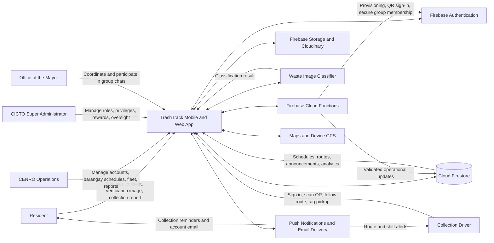
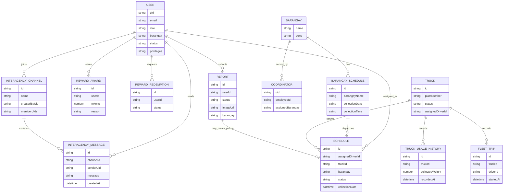

# TrashTrack Context Flow and Core Entities

This is the **system context flow diagram** and core entity view for the working TrashTrack prototype. It describes system actors and data exchanges; it is not a conceptual framework.

## Context Flow

## Core Entities

The diagrams summarize the main flows and collections used by the prototype. Optional fields and supporting collections are omitted for readability.
